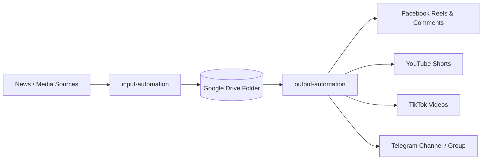

# ⚡ Automation Architecture (Two Independent Node.js Apps)

This project is partitioned into two completely independent, decoupled Node.js applications:



---

## 📦 Applications

### 1. `input-automation`
> **Source ➔ AI / TTS & News Card ➔ 9:16 Video Reel ➔ Google Drive Folder**
- Ingests breaking news & articles from RSS feeds or media sources.
- Generates Edge Neural TTS voiceover (`bn-BD` Bengali and `en-US` English).
- Renders high-contrast news cards via `@napi-rs/canvas`.
- Encodes 1080x1920 9:16 vertical video with FFmpeg (audio normalization, waveform, animated ticker).
- Uploads `.mp4` videos directly to the assigned Google Drive folder.
- **Port:** `3001`
- **Webhook trigger:** `POST /api/cron/input`
- **Directory:** `./input-automation`

### 2. `output-automation`
> **Google Drive Folder ➔ Facebook / YouTube / TikTok / Telegram ➔ Drive Auto-Trash**
- Scans Google Drive folder for pending videos (FIFO queue / oldest-first).
- Publishes to Facebook Page Reels via Meta Graph API v21.0.
- Automatically posts a high-CTR first comment containing the news link.
- Publishes to YouTube Shorts via YouTube Data API v3.
- Publishes to TikTok via TikTok Content Posting API.
- Publishes video directly (`sendVideo`) and announcement cards (`sendMessage`) to Telegram channels or groups.
- Deletes or trashes published videos from Google Drive to avoid repeat postings.
- **Port:** `3002`
- **Webhook trigger:** `POST /api/cron/output`
- **Directory:** `./output-automation`

---

## 🚀 Running from Root

```bash
# 1. Input Automation
pnpm input:dev       # Dev server
pnpm input:run       # Single execution via CLI

# 2. Output Automation
pnpm output:dev      # Dev server
pnpm output:publish  # Single publication via CLI
```
