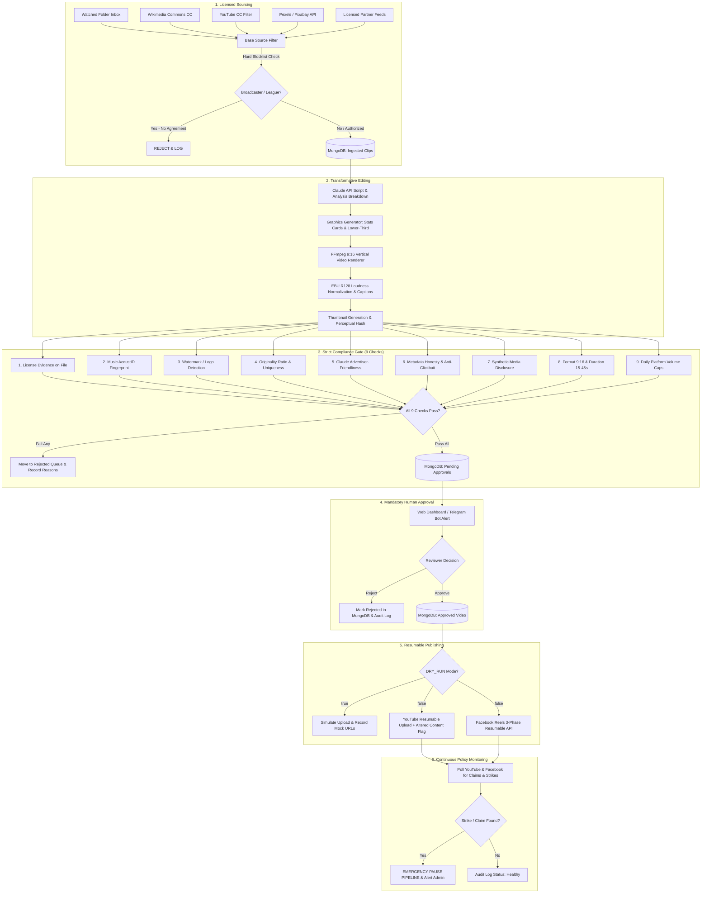

# ⚡ SportsClipBot

> **Autonomous Sports Clip Transformer & Publisher with Strict Monetization Compliance Gating**  
> Built with TypeScript (strict), Node 20+, ESM, pnpm, MongoDB, FFmpeg, Anthropic Claude API, and Meta/Google APIs.

---

## 🎯 Top Design Goal & Compliance Mandate

The primary design principle of **SportsClipBot** is uncompromising compliance with the **YouTube Partner Program (YPP)** (including reused and inauthentic content policies) and **Facebook Content Monetization Policies**.

> [!IMPORTANT]
> **Strict Compliance Gate**: If a video cannot pass all 9 compliance checks, it **MUST NOT** be published. Nothing is ever force-published. Every single video requires explicit human approval before being distributed to YouTube or Facebook.

---

## 🏗 High-Level Architecture & Pipeline Flow



---

## 📋 Monetization Policy Checklist

Because YouTube and Meta policies are updated periodically, re-verify your publishing parameters against these official documentation hubs:

### 🔴 YouTube Partner Program (Google)
1. **Reused & Repetitious Content Policy**:  
   [YouTube Channel Monetization Policies](https://support.google.com/youtube/answer/1311392)  
   *Requirement*: Content must feature significant original commentary, educational value, or narrative transformation. Mere compilation or raw clip reposting results in demonetization.
2. **Advertiser-Friendly Content Guidelines**:  
   [Advertiser-Friendly Guidelines (Ad Suitability)](https://support.google.com/youtube/answer/6162278)  
   *Requirement*: No graphic injuries, violent altercations, hate speech, gambling promotion, or deceptive medical misinformation.
3. **Altered or Synthetic Content Disclosure**:  
   [How to Disclose Altered or Synthetic Content](https://support.google.com/youtube/answer/14328491)  
   *Requirement*: Mandatory `containsSyntheticMedia: true` flag and description notice for AI-generated voiceovers or altered visuals.
4. **Spam, Deceptive Practices, and Scams**:  
   [YouTube Spam & Deceptive Metadata Policy](https://support.google.com/youtube/answer/2801973)  
   *Requirement*: No misleading clickbait, no tag stuffing (max 15 relevant tags), accurate thumbnails.

### 🔵 Meta Content Monetization (Facebook Reels)
1. **Content Monetization Policies**:  
   [Meta Content Monetization Guidelines](https://www.facebook.com/business/help/251390491959461)  
   *Requirement*: Creator must demonstrate significant value-add; raw footage aggregation is penalized with a "Limited Originality of Content" (LOC) flag.
2. **Facebook Community Standards**:  
   [Facebook Community Standards](https://transparency.fb.com/policies/community-standards/)  
   *Requirement*: Authentic engagement, brand safety, no intellectual property infringement.
3. **Intellectual Property Rights**:  
   [Meta Copyright and Trademark Help](https://www.facebook.com/help/325058084212425)  
   *Requirement*: Verifiable commercial rights on all video and audio assets.

---

## 🛠 Tech Stack

- **Runtime**: Node.js 20+ (ESM, strict TypeScript)
- **Package Manager**: `pnpm`
- **Database**: `mongodb` (supports MongoDB Atlas & self-hosted instances)
- **Config & Validation**: `zod` for `config.yaml` and `.env`
- **Video Editing**: `fluent-ffmpeg` / `child_process` with bundled `@ffmpeg-installer` and `@ffprobe-installer`
- **Audio Fingerprinting**: Chromaprint (`fpcalc` CLI) + AcoustID REST API
- **Perceptual Hashing**: `sharp` 64-bit difference hash (dHash) & Levenshtein text similarity
- **Scriptwriting & Screening**: `@anthropic-ai/sdk` (Claude 3.5 Sonnet)
- **Platforms**:
  - YouTube Data API v3 (`googleapis` resumable uploads)
  - Facebook Graph API v21.0 (`undici` / native `fetch` 3-phase Reels upload)
- **Approval & Notifications**: `grammy` Telegram bot + Express & EJS Dashboard
- **Scheduling**: `node-cron`
- **Testing**: `vitest`

---

## 📁 Project Structure

```
├── src/
│   ├── index.ts                     # Main entrypoint: starts scheduler, web server, telegram bot
│   ├── config/                      # Zod validation schemas for config.yaml and .env
│   ├── types/                       # Domain types, interfaces, enums
│   ├── db/                          # MongoDB connection, indexes, typed repository
│   ├── sources/                     # Pluggable sources: WatchedFolder, Wikimedia, YouTubeCC, Pexels, Pixabay, PartnerFeed
│   ├── compliance/                  # 9-check compliance gate, dHash perceptual hashing, AcoustID fingerprinting
│   ├── editor/                      # FFmpeg vertical editor, graphics generator, captions, script writer
│   ├── approval/                    # Human approval manager & grammY Telegram bot
│   ├── publishers/                  # YouTube & Facebook publishers with backoff retries & DRY_RUN
│   ├── monitoring/                  # Copyright & strikes monitoring with emergency pause
│   ├── scheduler/                   # node-cron scheduler and in-process job queue
│   └── server/                      # Express dashboard and approval API
├── tests/
│   ├── license.test.ts              # Unit tests for commercial vs NC license verification
│   ├── originality.test.ts          # Unit tests for 60% licensed ratio limit & uniqueness
│   ├── compliance-gate.test.ts      # Integration tests for 9-check Compliance Gate
│   ├── dedup.test.ts                # Unit tests for dHash & Levenshtein text similarity
│   ├── sources.test.ts              # Unit tests for broadcaster/league blocklists
│   └── publishers.test.ts           # Unit tests for publishers and DRY_RUN mode
├── config.yaml                      # Declarative application configuration
├── .env.example                     # Environment template
├── Dockerfile                       # Multi-stage production container
├── docker-compose.yml               # Container orchestration
└── docs/
    ├── GOOGLE_OAUTH_SETUP.md        # YouTube OAuth2 credentials guide
    └── FACEBOOK_APP_SETUP.md        # Facebook developer app & Page token guide
```

---

## 🚀 Quickstart & Setup

### 1. Prerequisites
- Node.js `20.x` or higher
- `pnpm` (`npm install -g pnpm`)
- Optional: `ffmpeg` & `fpcalc` (bundled in Docker; Windows binaries included in npm dependencies)

### 2. Installation
```bash
git clone <repo-url>
cd sportsclipbot
pnpm install
```

### 3. Environment Configuration
Copy `.env.example` to `.env`:
```bash
cp .env.example .env
```
Populate your credentials:
- **YouTube OAuth**: See [docs/GOOGLE_OAUTH_SETUP.md](file:///d:/WEBSITES/Vercel/FB%20Automation/docs/GOOGLE_OAUTH_SETUP.md)
- **Facebook Reels**: See [docs/FACEBOOK_APP_SETUP.md](file:///d:/WEBSITES/Vercel/FB%20Automation/docs/FACEBOOK_APP_SETUP.md)
- **Anthropic API**: From [console.anthropic.com](https://console.anthropic.com/)
- **Telegram Bot**: From [@BotFather](https://t.me/BotFather)

### 4. Running Tests
```bash
pnpm test
```
Runs 28 comprehensive unit & integration tests covering license verification, originality metrics, dedup hashing, blocklist enforcement, and compliance gating.

### 5. Running the Application
```bash
# Development mode with hot-reload
pnpm dev

# Build and production start
pnpm build
pnpm start
```

### 6. Running with Docker Compose
```bash
docker-compose up --build -d
```
The web dashboard will be accessible at: `http://localhost:3000`.

---

## 🛡 Sourcing Rules & Hard Blocklist

`SportsClipBot` enforces strict sourcing rules:
1. **Allowed**:
   - Creator-owned footage placed in `./data/inbox` with a companion `<name>.license.json` or `.license.txt` permission note.
   - Creative Commons Attribution (`CC_BY`) and Public Domain (`CC0`).
   - Pexels & Pixabay commercial license video APIs.
   - Authorized partner feeds configured with formal agreement IDs in `config.yaml`.
2. **Unconditionally Rejected**:
   - Broadcasters: ESPN, Sky Sports, NBC Sports, BBC Sport, Fox Sports, DAZN, TNT Sports, Star Sports, Eurosport, etc.
   - Leagues: FIFA, UEFA, Premier League, La Liga, NBA, NFL, MLB, NHL, Formula 1, ICC, etc.
   - Non-Commercial licenses: `CC-BY-NC`, `CC-BY-NC-SA`, `CC-BY-NC-ND`.
   - Watermarked footage from TikTok, Instagram Reels, or third-party TV feeds.

---

## 🔒 Mandatory Human Approval Workflow

1. Processed videos appear on the Web Dashboard (`http://localhost:3000/dashboard`) and are pushed to the Telegram Admin Chat.
2. The card displays:
   - Video title and 9:16 poster preview
   - License evidence reference & source proof URL
   - Full 9-check Compliance Gate report
   - Originality ratio (e.g. 45% original analysis, 55% licensed footage)
   - Narration script
3. Only clicking **[Approve & Publish]** releases the video to YouTube and Facebook.
4. The reviewer's identity and timestamp are permanently written to MongoDB `approvals` and `audit_log` collections.

---

## 🚨 Emergency Strike Pause

If YouTube or Facebook flags a copyright claim, Content ID restriction, or strike:
1. The `CopyrightMonitor` immediately halts the pipeline.
2. `pipeline_state.is_paused` is set to `true`.
3. Admin receives an urgent alert.
4. The pipeline cannot publish new content until manually investigated and resumed from the web dashboard.
